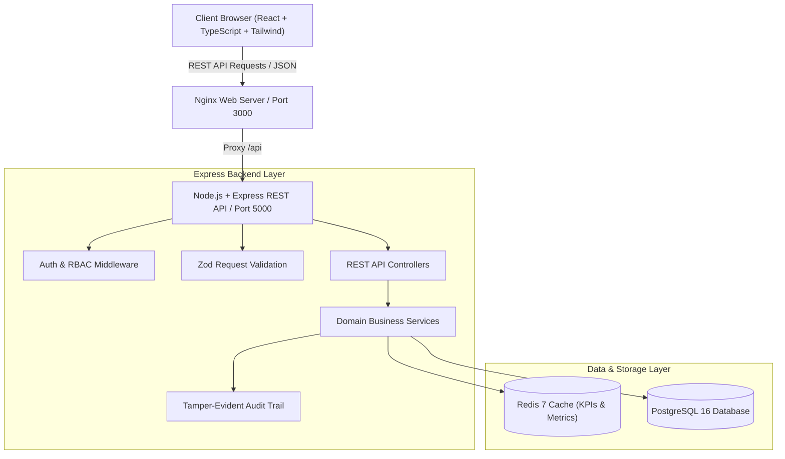

# EnviroTrack Infra — Infrastructure Environmental Assessment & Compliance Management System

[](https://github.com/envirotrack/infra-compliance/actions/workflows/ci.yml)
[](https://nodejs.org)
[](https://expressjs.com)
[](https://react.dev)
[](https://www.typescriptlang.org)
[](https://www.postgresql.org)
[](https://redis.io)
[](https://www.docker.com)
[](LICENSE)

**EnviroTrack Infra** is an enterprise full-stack platform designed to systematically manage **Environmental Impact Assessments (EIA / SIA)**, **Statutory Regulatory Clearances (MoEFCC EC, FC Stage 1 & 2, Wildlife NBWL, CRZ, SPCB CTE/CTO)**, **Environmental Management Plan (EMP) Mitigation Measures**, **IoT Sensor Telemetry (CAAQMS Air & Noise)**, and **Six-Monthly Compliance Documentation & NCR Workflows** for large-scale infrastructure projects.

---

## 🏗️ Tech Stack

| Layer | Technology |
|---|---|
| **Frontend UI** | **React 18+**, **TypeScript**, **Vite**, **Tailwind CSS**, **Lucide Icons**, **Recharts** |
| **Backend API** | **Node.js 20+**, **Express.js**, **TypeScript**, Layered Controller-Service-Repository Pattern, Zod Schema Validation |
| **Database** | **PostgreSQL 16** with schema migrations, indexes, and full relational integrity |
| **Caching & Invalidation** | **Redis 7** for executive KPI caching, rate-limiting, and SLA countdowns |
| **Containerization** | **Docker & Docker Compose** multi-container orchestration |
| **DevOps & CI/CD** | **GitHub Actions** (`ci.yml`), automated type-check, lint, and test runner |

---

## 📐 System Architecture



---

## 🌿 Core Functional Modules

1. **Executive Command Center & Analytics**:
   - Algorithmic composite compliance health score ($0-100\%$).
   - Active statutory clearances SLA countdown risk meter.
   - EMP allocated vs spent budget progress comparison.
   - Real-time IoT sensor anomaly alerts banner.

2. **Infrastructure Projects Directory**:
   - Multi-sector classification: *Highways & Expressways, Rail & Metro Transit, Hydroelectric & Water Resources, Renewable Energy (Solar/Wind), Ports & Maritime, Urban Mass Transit*.
   - Geographic coordinates, state/country, proximity to Eco-Sensitive Zones (ESZ) and Protected Reserve Forests.

3. **Environmental Impact Assessments (EIA / SIA)**:
   - Terms of Reference (ToR) tracking, Public Hearing consultation milestones.
   - Baseline monitoring parameters: Ambient PM2.5, PM10, SO2, NOx, Noise dB(A), Seawater Turbidity, Groundwater pH, River BOD/COD.
   - Interactive Leopold Impact Significance & Mitigation Matrix.

4. **Statutory Approvals & Regulatory Clearances Engine**:
   - Stage-gate approvals: MoEFCC Environmental Clearance (EC Category A/B), Forest Clearance (FC Stage 1/2), Standing Committee NBWL Wildlife Clearance, Coastal Regulation Zone (CRZ), State PCB Consent to Establish (CTE) & Operate (CTO).
   - Interactive toggleable specific & general conditions compliance checklists.

5. **Mitigation Measures & EMP Engine**:
   - Compensatory Afforestation, High-pressure dust mist cannons, Wildlife eco-duct passes, Muck disposal bio-engineering, Effluent Zero Liquid Discharge (ZLD).
   - Milestones, physical progress slider ($0-100\%$), contractor assignments, and field drone evidence logs.

6. **Statutory Compliance Repository & 6-Monthly Compiler**:
   - Cryptographically sealed document vault with SHA-256 integrity verification.
   - One-click compiler generating official Six-Monthly Environmental Compliance Packages for PARIVESH / CPCB submissions.

7. **IoT Continuous Environmental Telemetry**:
   - Real-time stream simulation for CAAQMS stations, particulate monitoring, and decibel noise sensors with advisory threshold triggers.

8. **Non-Compliance Reporting (NCR) & CAP Workflows**:
   - Formal breach notice issuance, severity grading (Minor, Major, Critical), Corrective Action Plan (CAP) submission, and inspection closure.

9. **GIS Geospatial Corridor Mapping**:
   - Geospatial overlay with WGS84 coordinate projections, project alignment nodes, and eco-sensitive buffer indicators.

10. **Immutable Audit Trail**:
    - Timestamped activity logs with officer role, IP address, payload summaries, and verification seals.

---

## 🚀 Quick Start with Docker Compose

To start the complete multi-container stack (React Frontend, Express Backend, PostgreSQL, and Redis):

```bash
# 1. Clone or navigate to the repository
cd "d:/full stack project"

# 2. Start all services via Docker Compose
docker-compose up --build
```

Access the applications:
- **Frontend Dashboard**: `http://localhost:3000`
- **Backend REST API**: `http://localhost:5000/api/v1`
- **API Health Check**: `http://localhost:5000/api/v1/health`
- **PostgreSQL Database**: `localhost:5432` (`envirotrack_db`)
- **Redis Cache**: `localhost:6379`

---

## 💻 Local Development Setup

### Backend (`/server`)

```bash
cd server
npm install
npm run seed     # Initialize schema and seed database
npm run dev      # Start hot-reloading development server on port 5000
npm test         # Run automated API integration test suite
```

### Frontend (`/client`)

```bash
cd client
npm install
npm run dev      # Start Vite React development server on port 3000
npm run build    # Compile production distribution bundle
```

---

## 📡 REST API Reference

| Method | Endpoint | Description | Access Role |
|---|---|---|---|
| `GET` | `/api/v1/health` | Service health and uptime | Public |
| `POST` | `/api/v1/auth/login` | Officer / Admin login token | Public |
| `GET` | `/api/v1/projects` | List all infrastructure projects | Authenticated |
| `POST` | `/api/v1/projects` | Register new capital project | Officer / Admin |
| `GET` | `/api/v1/assessments` | Get EIA / SIA assessment studies | Authenticated |
| `GET` | `/api/v1/approvals` | Statutory clearances and SLA status | Authenticated |
| `PATCH` | `/api/v1/approvals/:id/conditions/:condId` | Toggle condition compliance state | Auditor / Officer |
| `GET` | `/api/v1/mitigations` | EMP mitigation measures list | Authenticated |
| `PUT` | `/api/v1/mitigations/:id` | Update physical progress % & spend | Officer / PM |
| `GET` | `/api/v1/compliance/documents` | Document vault records | Authenticated |
| `POST` | `/api/v1/compliance/generate-report` | Auto-compile 6-monthly dossier | Auditor / Officer |
| `GET` | `/api/v1/compliance/ncrs` | Non-Compliance Reports list | Authenticated |
| `POST` | `/api/v1/compliance/ncrs` | Issue new statutory NCR notice | Auditor / Officer |
| `GET` | `/api/v1/sensors/telemetry` | Live IoT sensor telemetry feed | Authenticated |
| `GET` | `/api/v1/analytics/dashboard` | Aggregated executive KPIs | Authenticated |
| `GET` | `/api/v1/analytics/audit-logs` | Audit trail history | Auditor / Admin |

---

## 🔒 Security & Compliance Standards

- **ISO 14001:2015**: Environmental Management Systems alignment.
- **MoEFCC EIA Notification 2006**: Structured ToR, public hearings, and appraisal stage gates.
- **CPCB CAAQMS Standards**: Real-time ambient air quality parameter ingestion.
- **Role-Based Access Control (RBAC)**: Admin, Environmental Officer, Compliance Auditor, Project Manager, Regulatory Authority.
- **Cryptographic Document Integrity**: SHA-256 hashing for all uploaded compliance evidence.
